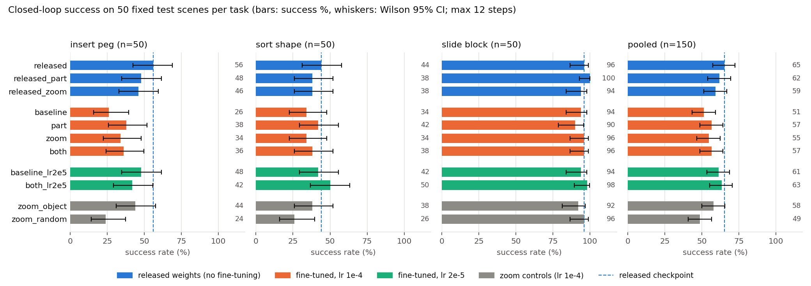

# Results: part-aware sampling and part zoom for 3D Diffuser Actor

> **Status: final (2026-11-23).** All 11 variants have 3 tasks × 50 closed-loop episodes, and all offline evaluations, sweeps and the clean inference benchmark are finished. Nothing had to be rerun.
>
> **Regions are oracle, privileged simulator information** (DATASET.md §5). Every number with "part", "zoom" or "both" in its name uses ground-truth part boxes.
>
> Every number below comes from `results/tables.md` (`code/partzoom/make_package.py`) or `results/tables_extra.md` (`code/partzoom/extra_tables.py`). Both are computed from the raw per-episode files in `results/rollouts/` and `results/offline/`.

## Key findings

- **The released checkpoint is the best configuration overall: 65% pooled (98/150).** No fine-tuned model and no zero-shot application of the methods beats it. The best fine-tuned model is **`both_lr2e5`** (part sampling + part zoom, lr 2e-5) at **63%** (95/150). That is 2 points lower than the released checkpoint and statistically indistinguishable from it (paired McNemar p = 0.755). It does better on sort shape (+6) and slide block (+2) but worse on insert peg (−14).
- **Against the matched fine-tuned baseline (lr 1e-4), every method is ahead but none is significantly ahead.** Pooled gains: part-aware sampling +5.3 points (p = 0.22), part zoom +3.3 (p = 0.50), both +5.3 (p = 0.26). The largest gains are on insert peg (+8 to +12 points), and none of them is significant at n = 50.
- **At lr 2e-5 the methods' advantage almost disappears.** `both_lr2e5` vs `baseline_lr2e5` is +2.0 points pooled (p = 0.74), and −6 on insert peg.
- **The lower learning rate largely fixes the fine-tuning regression.** At lr 1e-4, fine-tuning drops the released model from 65% to 51% (−14, p = 0.001). At lr 2e-5 the drop shrinks to −4 (61%, p = 0.36). The lr 2e-5 baseline is significantly better than the lr 1e-4 baseline (+10, p = 0.008).
- **Applied zero-shot to the released weights, the methods hurt slightly** (not significantly): part sampling −3.3 (p = 0.38), part zoom −6.0 (p = 0.14).
- **Focused zoom beats random-region zoom, but there is no evidence that focusing on the *part* beats focusing on the whole object.** Pooled success: whole-object zoom 58%, part zoom 55%, random-region zoom 49%. Only object vs random is significant (+9.3, p = 0.029). Part vs random is +6.0 (p = 0.19). Part vs object is −3.3 (p = 0.54).
- **Offline, zoom clearly lowers the position error of interaction keyframes.** Pooled error: both 0.35 cm vs baseline 0.57 cm, with a paired bootstrap CI that excludes 0. On insert peg: 0.23 cm vs 0.63 cm. The effect fades once region localisation is off by more than about 1 cm (see the sweeps), it does not improve rotation, and it does not turn into a significant closed-loop gain.
- **Cost is small.** On an idle T4, part sampling adds 9% to the time per step, zoom adds 1% and both add 8% (1.86 → 2.01 s/step). Peak GPU memory is unchanged.

*Figure: closed-loop success per task and variant, with Wilson 95% CIs. The dashed line is the released checkpoint. Regenerate with `python partzoom/make_fig.py`.*

## 1. Protocol

**Test scenes.** There are 50 fixed scenes per task (`data/seeds/test`, episodes 0–49), 150 in total. Every variant runs on exactly the same scenes, restored with `reset_to_demo`.

**Closed loop.** At each step the model predicts the next keypose with 100 denoising steps. The controller is RLBench `EndEffectorPoseViaPlanning` without collision checking and with up to 2 planning tries per step. This mirrors upstream `online_evaluation_rlbench/evaluate_policy.py`. An episode ends when the task's success condition fires or after **12 steps**.
- Upstream uses 25 steps. In a 25-step run of the released checkpoint on insert peg, every success happened by step 6, so 12 steps changes no outcome and halves the evaluation cost.
- Fixed per-episode seeds control the policy noise and the instruction paraphrase.

**Fine-tuning.** Every fine-tuned variant is initialised from the released PerAct checkpoint and trained on identical data: 100 demos per task across 3 tasks, one multi-task model.
- 4000 iterations, batch 4 episodes (up to 5 keyframes each), Adam, the same seed and the same augmentation. The learning rate is 1e-4, or 2e-5 for the `_lr2e5` runs.
- The checkpoint after the final iteration (`last.pth`) is evaluated. No checkpoint selection is done on test data.
- There is **one training seed per variant**.

**Variants.**

| name | weights | tokens in the 819 budget |
|---|---|---|
| `released` | released 18-task PerAct checkpoint | FPS (upstream) |
| `released_part`, `released_zoom` | released, no training | part-aware sampling / part zoom, applied zero-shot |
| `baseline` | fine-tuned, lr 1e-4 | FPS: the matched baseline |
| `part`, `zoom`, `both` | fine-tuned, lr 1e-4 | part-aware sampling / part zoom / both |
| `baseline_lr2e5`, `both_lr2e5` | fine-tuned, lr 2e-5 | FPS / both |
| `zoom_object`, `zoom_random` | fine-tuned, lr 1e-4 | zoom around the whole object / a random region of the same size (secondary controls) |

**Statistics.**
- Success-rate intervals are Wilson 95% intervals.
- Variant-to-variant comparisons are **paired** (same scenes) and use the exact two-sided McNemar test on discordant episodes. *wins* = scenes only the variant solved; *losses* = scenes only the reference solved.
- With n = 50 per task, a difference has to be about 15–20 points to reach p < 0.05 on one task. The pooled 150-episode test is the more sensitive one.
- No correction for multiple comparisons is applied. This file reports about 75 paired tests (per task and pooled), so 3–4 nominal p < 0.05 results are expected by chance alone. Read isolated per-task "significant" results with that in mind.

## 2. Main result: success rate

Values are success % (successes/episodes) [Wilson 95% CI].

| variant | insert peg | sort shape | slide block | pooled (150) | mean of tasks |
|---|---|---|---|---|---|
| **`released`** (no fine-tuning) | **56** (28/50) [42–69] | 44 (22/50) [31–58] | 96 (48/50) [87–99] | **65** (98/150) [57–72] | **65.3** |
| `released_part` (zero-shot) | 48 (24/50) [35–61] | 38 (19/50) [26–52] | **100** (50/50) [93–100] | 62 (93/150) [54–69] | 62.0 |
| `released_zoom` (zero-shot) | 46 (23/50) [33–60] | 38 (19/50) [26–52] | 94 (47/50) [84–98] | 59 (89/150) [51–67] | 59.3 |
| `baseline` (FPS, lr 1e-4) | 26 (13/50) [16–40] | 34 (17/50) [22–48] | 94 (47/50) [84–98] | 51 (77/150) [43–59] | 51.3 |
| `part` | 38 (19/50) [26–52] | 42 (21/50) [29–56] | 90 (45/50) [79–96] | 57 (85/150) [49–64] | 56.7 |
| `zoom` | 34 (17/50) [22–48] | 34 (17/50) [22–48] | 96 (48/50) [87–99] | 55 (82/150) [47–62] | 54.7 |
| `both` | 36 (18/50) [24–50] | 38 (19/50) [26–52] | 96 (48/50) [87–99] | 57 (85/150) [49–64] | 56.7 |
| `baseline_lr2e5` | 48 (24/50) [35–61] | 42 (21/50) [29–56] | 94 (47/50) [84–98] | 61 (92/150) [53–69] | 61.3 |
| **`both_lr2e5`** | 42 (21/50) [29–56] | **50** (25/50) [37–63] | 98 (49/50) [90–100] | 63 (95/150) [55–71] | 63.3 |
| `zoom_object` | 44 (22/50) [31–58] | 38 (19/50) [26–52] | 92 (46/50) [81–97] | 58 (87/150) [50–66] | 58.0 |
| `zoom_random` | 24 (12/50) [14–37] | 26 (13/50) [16–40] | 96 (48/50) [87–99] | 49 (73/150) [41–57] | 48.7 |

The published 3DDA PerAct success rates are 65.6% on insert peg and 44.0% on sort shape, and slide block is near ceiling. Our reproduction of the released checkpoint lands within those confidence intervals.

### 2a. Paired comparison against the matched fine-tuned baseline

The matched baseline is the comparison the proposal specifies: same data, same fine-tuning recipe, same token budget. For the lr 2e-5 runs, the matched reference is `baseline_lr2e5`.

| variant | reference | insert peg Δ (w/l, p) | sort shape Δ (w/l, p) | slide block Δ (w/l, p) | **pooled Δ (w/l, p)** |
|---|---|---|---|---|---|
| `part` | `baseline` | +12.0 (11/5, 0.210) | +8.0 (7/3, 0.344) | −4.0 (2/4, 0.688) | **+5.3** (20/12, 0.215) |
| `zoom` | `baseline` | +8.0 (10/6, 0.454) | 0.0 (7/7, 1.000) | +2.0 (3/2, 1.000) | **+3.3** (20/15, 0.500) |
| `both` | `baseline` | +10.0 (12/7, 0.359) | +4.0 (8/6, 0.791) | +2.0 (3/2, 1.000) | **+5.3** (23/15, 0.256) |
| `both_lr2e5` | `baseline_lr2e5` | −6.0 (7/10, 0.629) | +8.0 (10/6, 0.454) | +4.0 (3/1, 0.625) | **+2.0** (20/17, 0.743) |

Δ is in success-rate points, w/l are wins/losses, and p is the exact McNemar p-value. **No comparison against a matched baseline is significant**, on any task or pooled.

### 2b. Paired comparison against the released checkpoint

| variant | insert peg Δ (w/l, p) | sort shape Δ (w/l, p) | slide block Δ (w/l, p) | **pooled Δ (w/l, p)** |
|---|---|---|---|---|
| `baseline` | −30.0 (1/16, **0.000**) | −10.0 (5/10, 0.302) | −2.0 (1/2, 1.000) | **−14.0** (7/28, **0.001**) |
| `part` | −18.0 (7/16, 0.093) | −2.0 (8/9, 1.000) | −6.0 (0/3, 0.250) | **−8.7** (15/28, 0.066) |
| `zoom` | −22.0 (7/18, **0.043**) | −10.0 (8/13, 0.383) | 0.0 (2/2, 1.000) | **−10.7** (17/33, **0.033**) |
| `both` | −20.0 (9/19, 0.087) | −6.0 (7/10, 0.629) | 0.0 (2/2, 1.000) | **−8.7** (18/31, 0.085) |
| `baseline_lr2e5` | −8.0 (5/9, 0.424) | −2.0 (6/7, 1.000) | −2.0 (1/2, 1.000) | **−4.0** (12/18, 0.362) |
| `both_lr2e5` | −14.0 (7/14, 0.189) | +6.0 (10/7, 0.629) | +2.0 (2/1, 1.000) | **−2.0** (19/22, 0.755) |
| `zoom_object` | −12.0 (10/16, 0.327) | −6.0 (4/7, 0.549) | −4.0 (2/4, 0.688) | **−7.3** (16/27, 0.126) |
| `zoom_random` | −32.0 (4/20, **0.002**) | −18.0 (2/11, **0.022**) | 0.0 (2/2, 1.000) | **−16.7** (8/33, **0.000**) |

The paired comparisons of the zero-shot variants against the released checkpoint are in §3.

### 2c. Effect of the learning rate (same method, lr 2e-5 vs lr 1e-4)

| variant | reference | insert peg Δ (w/l, p) | sort shape Δ (w/l, p) | slide block Δ (w/l, p) | pooled Δ (w/l, p) |
|---|---|---|---|---|---|
| `baseline_lr2e5` | `baseline` | +22.0 (13/2, **0.007**) | +8.0 (7/3, 0.344) | 0.0 (2/2, 1.000) | **+10.0** (22/7, **0.008**) |
| `both_lr2e5` | `both` | +6.0 (14/11, 0.690) | +12.0 (10/4, 0.180) | +2.0 (2/1, 1.000) | **+6.7** (26/16, 0.164) |

## 3. Zero-shot: the methods on the released weights (no training)

| variant vs `released` | insert peg Δ (w/l, p) | sort shape Δ (w/l, p) | slide block Δ (w/l, p) | pooled Δ (w/l, p) |
|---|---|---|---|---|
| `released_part` | −8.0 (3/7, 0.344) | −6.0 (3/6, 0.508) | +4.0 (2/0, 0.500) | **−3.3** (8/13, 0.383) |
| `released_zoom` | −10.0 (7/12, 0.359) | −6.0 (2/5, 0.453) | −2.0 (1/2, 1.000) | **−6.0** (10/19, 0.136) |

Neither method helps without training. Part-aware sampling only changes *which* coarse tokens the released model attends to, and costs 3 points (not significant); it is the only variant that solved all 50 slide-block scenes. Zoom hands the released model fine-scale tokens of a kind it never saw in training, and costs 6 points (not significant). Offline, zero-shot part sampling is slightly but consistently *less* accurate than the released model (+0.03 cm position error, bootstrap CI [+0.02, +0.05]; §5).

## 4. Secondary comparisons: does focusing on the *part* matter?

All three zoom variants use the same budget (563 FPS coarse + 256 fine tokens), the same 8 crops of 128 × 128 and the same recipe (lr 1e-4). They differ only in where the crops land.

| comparison | insert peg Δ (w/l, p) | sort shape Δ (w/l, p) | slide block Δ (w/l, p) | pooled Δ (w/l, p) |
|---|---|---|---|---|
| part zoom vs whole-object zoom | −10.0 (8/13, 0.383) | −4.0 (7/9, 0.804) | +4.0 (4/2, 0.688) | **−3.3** (19/24, 0.542) |
| part zoom vs random-region zoom | +10.0 (12/7, 0.359) | +8.0 (9/5, 0.424) | 0.0 (2/2, 1.000) | **+6.0** (23/14, 0.188) |
| whole-object zoom vs random-region zoom | +20.0 (16/6, 0.052) | +12.0 (8/2, 0.109) | −4.0 (1/3, 0.625) | **+9.3** (25/11, **0.029**) |

Offline position error, paired by keyframe, with 95% CIs from resampling val episodes (`tables_extra.md`):

| comparison | Δ pos err, all keyframes (cm) | Δ pos err, interaction keyframes (cm) |
|---|---|---|
| part zoom − whole-object zoom | −0.03 [−0.12, +0.04] | −0.02 [−0.13, +0.06] |
| part zoom − random-region zoom | **−0.18 [−0.33, −0.06]** | **−0.31 [−0.57, −0.10]** |

**Answer: focusing the zoom matters; focusing on the *part* rather than the whole object does not, in these experiments.**
- Random-region zoom is the worst fine-tuned model (49%, below even the FPS baseline's 51%) and the least accurate offline (0.71 cm interaction error). Spending 256 tokens on the wrong place costs accuracy.
- Whole-object zoom (58%) is level with or slightly ahead of part zoom (55%) in closed loop, and the two are equally accurate offline. Whole-object crops have lower magnification (1.7× vs 2.5×) but find the object more often (89% vs 81% of crops; §6).
- The ordering object ≥ part > random fits "zoom helps when it looks at the task-relevant area". It does not support the proposal's specific claim that part-level granularity is what matters.

## 5. Alignment errors on held-out demos (offline)

The offline evaluation uses the 60 validation episodes (20 per task) × 2 seeds, 520 keyframe predictions per variant. Each prediction runs the full 100-step denoising and is compared with the demonstrated next keypose. *Interaction keyframes* are the second half of each episode (`kf ≥ T/2`): place, insert and push.

Pooled over the three tasks:

| variant | pos err cm (all kf) | rot err ° (all kf) | **pos err cm (interaction kf)** | rot err ° (interaction kf) | insert-peg pos err cm (interaction kf) | pos < 1 cm | gripper acc |
|---|---|---|---|---|---|---|---|
| `released` | 0.44 | 16.1 | 0.58 | 2.4 | 0.71 | 96% | 99% |
| `released_part` | 0.47 | 16.1 | 0.62 | 2.6 | 0.76 | 95% | 98% |
| `released_zoom` | 0.46 | 16.6 | 0.58 | 3.7 | 0.55 | 95% | 98% |
| `baseline` | 0.48 | 13.9 | 0.57 | 3.2 | 0.63 | 95% | 99% |
| `part` | 0.50 | 14.9 | 0.52 | 3.3 | 0.60 | 93% | 99% |
| `zoom` | 0.39 | 15.7 | 0.40 | 3.3 | 0.30 | 96% | 98% |
| `both` | 0.35 | 15.1 | 0.35 | 3.6 | 0.23 | 95% | 98% |
| `baseline_lr2e5` | 0.38 | 15.3 | 0.49 | 3.1 | 0.74 | 96% | 99% |
| `both_lr2e5` | **0.33** | 15.9 | **0.33** | 4.0 | 0.27 | 96% | 99% |
| `zoom_object` | 0.42 | 14.5 | 0.43 | 3.5 | 0.37 | 95% | 99% |
| `zoom_random` | 0.57 | 14.9 | 0.71 | 3.5 | 0.74 | 93% | 98% |

Per-task rows are in `results/tables.md` (section *offline*).

Paired differences in position error (cm), with 95% CIs from an episode-level bootstrap. `*` marks a CI that excludes 0.

| variant − reference | all keyframes | interaction keyframes |
|---|---|---|
| `part` − `baseline` | +0.02 [−0.12, +0.14] | −0.05 [−0.30, +0.16] |
| `zoom` − `baseline` | −0.09 [−0.31, +0.05] | −0.17 [−0.55, +0.06] |
| `both` − `baseline` | −0.12 [−0.35, +0.00] | **−0.23 [−0.60, −0.01]** * |
| `both_lr2e5` − `baseline_lr2e5` | −0.05 [−0.23, +0.09] | −0.16 [−0.43, +0.05] |
| `both_lr2e5` − `released` | −0.11 [−0.31, +0.06] | **−0.25 [−0.57, −0.00]** * |
| `baseline` − `released` | +0.04 [−0.08, +0.14] | −0.01 [−0.22, +0.15] |

How to read these:
- **Zoom reduces position error where the proposal predicts it should.** On insert-peg interaction keyframes, error falls from 0.63 cm (baseline) to 0.30 (zoom) and 0.23 (both), and to 0.27 for `both_lr2e5` vs 0.74 for `baseline_lr2e5`. Pooled, only `both` vs `baseline` and `both_lr2e5` vs `released` have CIs that exclude 0, and only just.
- **Part-aware sampling alone does not improve offline accuracy**, although it is ahead in closed loop at lr 1e-4.
- **Rotation is not improved.** Interaction-keyframe rotation error is 2.4° for the released model and 3.1–4.0° for every fine-tuned model, zoom variants included. The large all-keyframe rotation errors (14–17°) come almost entirely from the first keyframe, the grasp: in the variants checked (`released`, `baseline`, `both`), its mean error is 74–114° on insert peg and sort shape, while every later keyframe averages ≤ 11°. This most likely reflects the 90° symmetry of the ring and shapes, which the quaternion metric does not account for. It should not be read as a real 15° error.
- **The offline gains do not carry over to closed loop.** `both` has the lowest offline error at lr 1e-4 but is only +5 points (n.s.) in closed loop. `both_lr2e5` is the most accurate model offline yet still trails the released checkpoint on insert peg (42% vs 56%).

**Training-time validation** (8 val batches at the final iteration, from `logs/train_<name>.log`) is noisy. Over the four checkpoints, the baseline's final-keypose error ranged from 5.5 to 9.3 mm, so it is shown only for completeness.

| variant | final-keypose pos err (mm) | pos < 1 cm | quaternion L1 | quat L1 < 0.025 | gripper acc |
|---|---|---|---|---|---|
| `baseline` | 5.6 | 92.5% | 0.167 | 49.0% | 95.7% |
| `part` | 6.7 | 90.6% | 0.169 | 40.1% | 95.7% |
| `zoom` | 4.4 | 93.6% | 0.163 | 51.3% | 95.7% |
| `both` | 4.4 | 95.0% | 0.135 | 42.3% | 95.0% |
| `baseline_lr2e5` | 5.8 | 94.1% | 0.177 | 68.6% | 95.7% |
| `both_lr2e5` | 2.8 | 96.3% | 0.158 | 61.1% | 95.7% |
| `zoom_object` | 5.0 | 92.7% | 0.135 | 54.9% | 95.7% |
| `zoom_random` | 6.4 | 90.6% | 0.130 | 48.0% | 95.7% |

## 6. Token retention: where the 819-token budget goes

"In-region" means the token's 3D position lies inside an oracle box, padded by 1 cm. Region 0 is the manipulated part and region 1 is the receiving part; zoom controls use their own boxes.

**Offline (val keyframes).** The FPS models (released, baseline, baseline_lr2e5) were given part regions only to measure retention. FPS itself ignores them.

| run | in-region coarse available | kept | **retention** | share of 819 budget on parts | in-region fine tokens | crop magnification | crops with the part visible |
|---|---|---|---|---|---|---|---|
| FPS: `released` / `baseline` / `baseline_lr2e5` | 217 | 91 / 91 / 91 | **60%** | 11% | – | – | – |
| part sampling: `part`, `released_part` | 217 | 198 | **97%** | 24% | – | – | – |
| part zoom: `zoom` | 217 | 78 | 54% | 10% | 251 | 2.53× | 81% |
| part zoom: `released_zoom` | 217 | 69 | 49% | 8% | 251 | 2.53× | 81% |
| both: `both`, `both_lr2e5` | 217 | 169 | 90% | 21% | 251 | 2.53× | 81% |
| `zoom_object` (object boxes) | 1085 | 278 | 33% | 34% | 256 | 1.69× | 89% |
| `zoom_random` (random boxes) | 30 | 4 | 12% | 1% | 155 | 1.68× | 41% |

**Closed-loop rollouts (all test steps), from `tables.md`:** `part` keeps 95% of in-region coarse tokens and `both` 87%, with `zoom` at 55% and `released_part` at 96%. The zoom variants hold about 250 in-region fine tokens at 2.43–2.49× magnification, and 79–80% of crops find the part.

- **FPS already keeps 60% of part tokens**, about 91 tokens. Part-aware sampling raises that to 97%, which more than doubles the share of the budget spent on parts (11% → 24%). This change in what the model attends to is real but, by itself, gives no measurable accuracy gain.
- Zoom adds about 250 in-region fine tokens per step: roughly 2.7× as many in-region tokens as FPS keeps, at 2.5× the resolution. That is the one change that moves the offline error.
- In about 19% of (region, camera) pairs the part is not visible (occluded, or outside that camera's view), and the crop falls back to the full image.

## 7. Eval-time sweeps (offline)

**These are eval-time sweeps: each model was trained once with the default settings** (no noise, margin 0.25, 256 zoom tokens, rel_cap 0.5), and only the inference-time setting was changed. They show sensitivity, not what training with that setting would give. Errors are offline (§5), in cm and degrees, pooled over tasks.

**Localisation noise.** Each region box is shifted by a random 3D offset (per axis, std σ), drawn independently per keyframe and per region.

| model | σ (m) | pos err (all kf) | pos err (interaction kf) | rot err ° (interaction kf) | insert-peg pos err (interaction kf) | crops with the part visible |
|---|---|---|---|---|---|---|
| `zoom` | 0 | 0.39 | 0.40 | 3.3 | 0.30 | 81% |
| `zoom` | 0.01 | 0.40 | 0.42 | 3.3 | 0.31 | 79% |
| `zoom` | 0.02 | 0.44 | 0.48 | 3.6 | 0.42 | 73% |
| `zoom` | 0.04 | 0.53 | 0.63 | 3.8 | 0.62 | 57% |
| `part` | 0 | 0.50 | 0.52 | 3.3 | 0.60 | – |
| `part` | 0.01 | 0.50 | 0.52 | 3.3 | 0.59 | – |
| `part` | 0.02 | 0.50 | 0.52 | 3.4 | 0.60 | – |
| `part` | 0.04 | 0.52 | 0.55 | 3.6 | 0.67 | – |
| `both` | 0 | 0.35 | 0.35 | 3.6 | 0.23 | 81% |
| `both` | 0.01 | 0.37 | 0.37 | 4.0 | 0.24 | 79% |
| `both` | 0.02 | 0.40 | 0.42 | 4.0 | 0.28 | 73% |
| `both` | 0.04 | 0.46 | 0.52 | 4.3 | 0.34 | 57% |

For reference, the `baseline` without regions has interaction error 0.57 cm overall and 0.63 cm on insert peg.
- 1 cm of noise is harmless.
- At 2 cm, about half of zoom's offline gain over the baseline is gone (interaction error 0.48 vs 0.40 clean and 0.57 for the baseline).
- At 4 cm, `zoom` is *worse* than the baseline (0.63 vs 0.57), because only 57% of crops still contain the part. `both` degrades more gently (0.52).
- Part sampling is insensitive to noise, consistent with its small effect overall.

**Crop margin** (`zoom`; margin as a fraction of box size added around the part):

| margin | 0.0 | 0.1 | **0.25 (default)** | 0.5 | 1.0 |
|---|---|---|---|---|---|
| pos err (all kf) | 0.42 | 0.39 | 0.39 | 0.41 | 0.44 |
| pos err (interaction kf) | 0.44 | 0.40 | 0.40 | 0.43 | 0.48 |
| insert-peg pos err (interaction kf) | 0.41 | 0.31 | 0.30 | 0.30 | 0.40 |

Margins of 0.1–0.5 are equivalent. A crop that is too tight (0.0) or too loose (1.0) is worse.

**Zoom token budget** (`zoom`; fine tokens out of 819, with the rest FPS coarse tokens):

| fine tokens | 128 | **256 (default)** | 384 |
|---|---|---|---|
| pos err (all kf) | 0.38 | 0.39 | 0.40 |
| pos err (interaction kf) | 0.40 | 0.40 | 0.41 |
| rot err ° (interaction kf) | 3.5 | 3.3 | 3.6 |

Flat. 128 fine tokens already capture the benefit, which fits the observation that only about 250 of the fine tokens fall in-region anyway.

**rel_cap** (`part`; maximum share of the budget for in-region coarse tokens):

| rel_cap | 0.25 | **0.5 (default)** | 0.75 |
|---|---|---|---|
| retention of in-region coarse tokens | 84% | 97% | 99% |
| pos err (all kf) | 0.50 | 0.50 | 0.50 |
| pos err (interaction kf) | 0.51 | 0.52 | 0.52 |

No effect on accuracy.

## 8. Failure types

| variant | insert peg: success / timeout / planner error | sort shape | slide block | mean steps to success (peg / shape / block) |
|---|---|---|---|---|
| `released` | 28 / 22 / 0 | 22 / 28 / 0 | 48 / 2 / 0 | 5.04 / 5.09 / 3.19 |
| `released_part` | 24 / 26 / 0 | 19 / 31 / 0 | 50 / 0 / 0 | 5.04 / 5.11 / 3.26 |
| `released_zoom` | 23 / 27 / 0 | 19 / 31 / 0 | 47 / 3 / 0 | 5.04 / 5.16 / 3.15 |
| `baseline` | 13 / 34 / 3 | 17 / 33 / 0 | 47 / 3 / 0 | 5.08 / 5.00 / 3.15 |
| `part` | 19 / 28 / 3 | 21 / 29 / 0 | 45 / 5 / 0 | 5.21 / 5.29 / 3.07 |
| `zoom` | 17 / 33 / 0 | 17 / 33 / 0 | 48 / 2 / 0 | 5.00 / 4.88 / 3.19 |
| `both` | 18 / 32 / 0 | 19 / 31 / 0 | 48 / 2 / 0 | 5.00 / 5.68 / 3.19 |
| `baseline_lr2e5` | 24 / 26 / 0 | 21 / 29 / 0 | 47 / 3 / 0 | 5.00 / 4.95 / 3.15 |
| `both_lr2e5` | 21 / 27 / 2 | 25 / 25 / 0 | 49 / 1 / 0 | 5.00 / 5.04 / 3.22 |
| `zoom_object` | 22 / 28 / 0 | 19 / 31 / 0 | 46 / 4 / 0 | 5.00 / 5.26 / 3.11 |
| `zoom_random` | 12 / 37 / 1 | 13 / 37 / 0 | 48 / 2 / 0 | 5.00 / 4.92 / 3.19 |

Almost every failure is a timeout: the arm reaches every predicted pose, but the poses are not accurate enough for the insertion or placement to register. There are 9 planner errors out of 1650 episodes, all on insert peg. Successful episodes take the same number of steps in every variant, so the methods change *whether* the task succeeds, not how quickly.

In the released checkpoint's insert-peg smoke-test failures we inspected by hand, the grasp position was right to within about 2 mm but the gripper yaw was about 50° off relative to the ring. That yaw error is the fine-geometry error the methods target. Consistent with §5, zoom improves position but not rotation, which may explain why the offline gains do not show up as successes.

## 9. Inference cost (clean benchmark)

The benchmark ran on an idle T4 at batch 1 with the released weights, on one insert-peg val frame. Each closed-loop step includes the full 100-step denoising. Results are the mean and minimum over 20 repetitions after 2 warm-up runs (`results/offline/bench_infer.json`).

| configuration | s/step (mean) | s/step (min) | vs FPS | peak GPU memory allocated |
|---|---|---|---|---|
| FPS (upstream) | 1.86 | 1.84 | – | 352 MiB |
| part-aware sampling | 2.03 | 2.01 | +9% | 352 MiB |
| part zoom | 1.88 | 1.87 | +1% | 352 MiB |
| both | 2.01 | 1.99 | +8% | 352 MiB |

- Part sampling adds two subset-FPS passes. Zoom adds one backbone pass over 8 crops of 128 × 128, about 50% of the full-image pixels, once per step rather than once per denoising step. That is why zoom is nearly free.
- Peak allocated memory is the same in every configuration, to within 1 MiB. At batch 1 it is set by the weights and the full-image encoding, and the crop pass is smaller than that.
- The per-step times recorded during the rollouts (5–6.5 s) are inflated because a training job shared the GPU. Use the clean numbers above.

## 10. Discussion

**What beats what.**
- *Against the matched fine-tuned baseline (lr 1e-4)*, all three methods are ahead pooled (part +5.3, zoom +3.3, both +5.3 points), mostly on insert peg (+8 to +12). This is the direction the proposal predicted, but **none of these differences is statistically significant**: the smallest pooled p is 0.215.
- *At lr 2e-5*, the matched gap shrinks to +2.0 pooled (p = 0.74), with insert peg reversed (−6). Once the baseline is trained well, the closed-loop benefit of part sampling + zoom is not detectable at this sample size.
- *Against the released checkpoint*, nothing is better. The best fine-tuned model, `both_lr2e5`, is 2 points behind (p = 0.76). It is ahead on sort shape (50% vs 44%) and slide block (98% vs 96%), and behind on insert peg (42% vs 56%).
- *Zero-shot* application to the released weights does not help (−3.3 and −6.0, n.s.).

**Best configuration overall:** the **released checkpoint (65%, 98/150)**. **Best fine-tuned configuration:** **`both_lr2e5` (63%, 95/150)**. It is also the most accurate model offline (0.33 cm interaction-keyframe position error vs 0.58 cm for the released model), but **it does not beat the released checkpoint** in closed loop.

**The fine-tuning regression.** Fine-tuning the 18-task released model on 300 demos of 3 tasks at lr 1e-4 and batch 4 costs 14 points (p = 0.001), almost all on insert peg (56% → 26%). Lowering the learning rate to 2e-5 recovers most of it: `baseline_lr2e5` is +10 over `baseline` (p = 0.008) and is no longer significantly below the released checkpoint (−4, p = 0.36). So the lower learning rate largely fixed the regression, but did not remove it. Insert peg is still 8 points lower for `baseline_lr2e5` and 14 points lower for `both_lr2e5`. Part of the methods' lr 1e-4 "gain" was probably recovered regression rather than a real improvement: at lr 1e-4 the methods may have acted partly as a regulariser against a poorly tuned recipe. With a gentler recipe their advantage mostly disappears.

**Does the part matter?** Zoom that looks at the task-relevant area beats zoom at random locations, both offline (significant) and in closed loop (object vs random significant; part vs random not). Part-level crops do no better than whole-object crops, in closed loop or offline. The data therefore support "spend fine tokens on the relevant object". They do not support "spend them on the relevant *part*".

**Offline vs closed loop.** Zoom consistently and substantially lowers position error at interaction keyframes, roughly halving it on insert peg. That gain does not show up as significantly more successes. Three likely reasons: rotation error, the dominant failure mode on insert peg, does not improve; the remaining position errors (about 0.3–0.6 cm) may already be below what matters for these tasks; and n = 50 per task can only detect gains of about 15–20 points.

**Limitations.**
- **Oracle regions.** All part, zoom and both results use ground-truth boxes from the simulator, which is privileged information a real robot does not have. The noise sweep shows that zoom's offline gain survives about 1 cm of localisation error, halves at 2 cm and reverses at 4 cm. A real part detector would need to localise parts to within about 1–2 cm.
- **n = 50 scenes per task.** Per-task differences under about 15–20 points cannot be resolved, and with about 75 uncorrected tests a few nominal p < 0.05 results are expected by chance.
- **One training seed per variant.** Seed-to-seed variance in fine-tuning is not measured, and could well be as large as the method effects reported here: the lr 1e-4 vs lr 2e-5 baselines alone differ by 10 points.
- **Short fine-tuning.** 4000 iterations at batch 4 is about 16k episode samples, far less than the released model's training. Neither learning rate was tuned beyond these two values, and `last.pth` is always used.
- **Three tasks only.** Slide block is at ceiling for every variant and contributes little signal.
- **Offline metrics.** The validation set is small (60 episodes), and the rotation metric is not symmetry-aware (§5).

## 11. Where the numbers come from

- `results/tables.md`: success, paired tests against `baseline` and `released`, failure types, rollout token statistics, training validation and offline errors. Built by `python partzoom/make_package.py`.
- `results/tables_extra.md`: the lr 2e-5 and zoom-control paired tests, offline token retention, offline bootstrap CIs, sweeps and the benchmark. Built by `python partzoom/extra_tables.py`, run after `make_package.py`.
- `figs/success_rates.png`: built by `python partzoom/make_fig.py`.
- Raw data: `results/rollouts/<variant>/<task>.jsonl` (one line per episode) and `results/offline/<name>.json` (one row per val keyframe and seed). The exact commands are in `code/partzoom/pipeline*.sh` and `code/partzoom/tmux/eval_worker.sh`. `logs/pipeline.log` is the timeline.
